&nbsp;&nbsp;

## `$ ls ~/in-production`

Management system for Loja's table tennis club: memberships, payment validation, attendance and ranking, plus a public site and a members' portal.

Storefront for an artisanal bakery with catalog and WhatsApp ordering, fed by an admin panel the owners run themselves.

## `$ ls ~/open-source`

- [yolo-complexity-lab](https://github.com/AlejandroTatum/yolo-complexity-lab) — YOLO11n vs Faster R-CNN vs SSDLite benchmark with a [live demo](https://yololab.streamlit.app/).
- [academic-report-automation](https://github.com/AlejandroTatum/academic-report-automation) — Markdown + YAML to university-grade PDF reports.
- [AlejandroTatum.github.io](https://github.com/AlejandroTatum/AlejandroTatum.github.io) — my portfolio: bilingual, terminal-style, static on GitHub Pages.

## `$ cat stack.txt`

`Python` `FastAPI` `TypeScript` `Next.js` `PostgreSQL` `Docker` `LLM tooling`

Open to part-time and contract work · remote · overlap with US hours.
